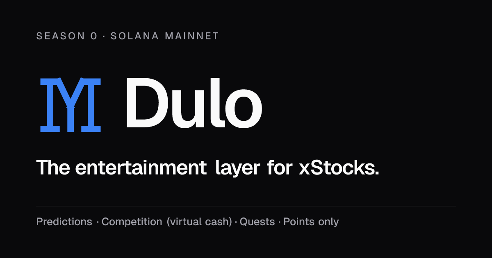
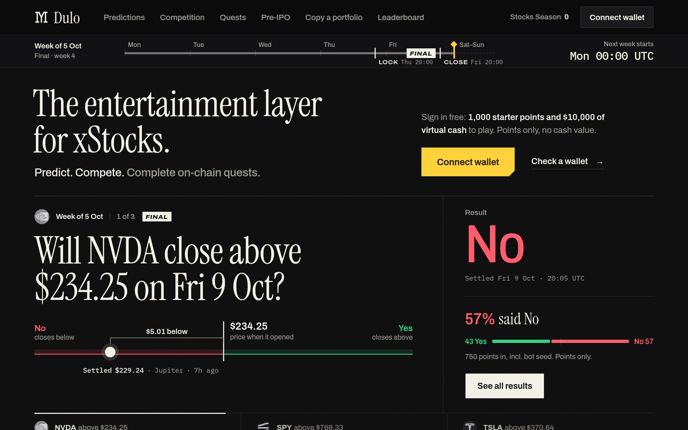
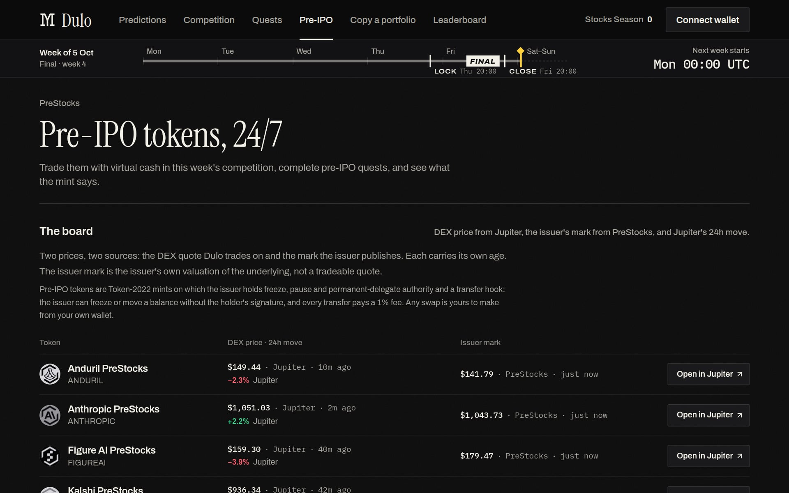
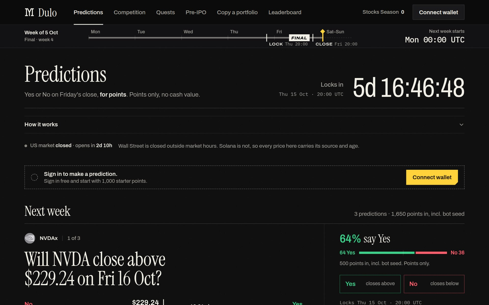
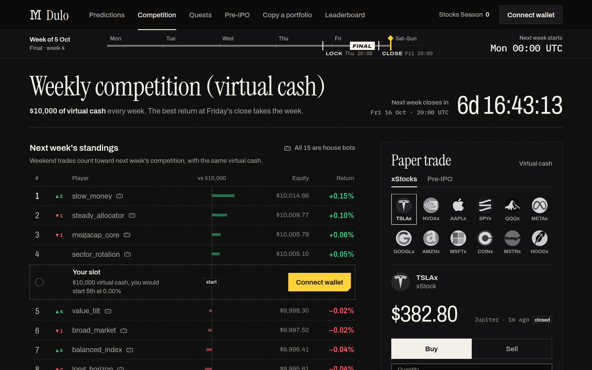
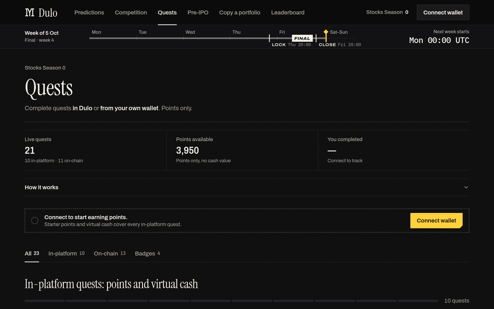

<div align="center">



**The entertainment layer for xStocks. Compete, predict and get rewarded, for points.**

[](https://github.com/djbigzzz/dulo/actions/workflows/ci.yml)
[](#run-locally)
[](#why-solana)
[](LICENSE)

</div>

---

Three games on one Season leaderboard: points-only **predictions** on Friday closes, a weekly **competition** with $10,000 of virtual cash at real xStock and pre-IPO prices, and **quests**, some completed in the app and some verified from your own Solana wallet with the proof attached. Every new player starts with 1,000 starter points. Points only, no cash value.

| | |
|---|---|
| **Live app** | **https://projectdulo.com**, reading Solana mainnet |
| **Try it** | **[projectdulo.com/start](https://projectdulo.com/start)**: a four-step tour (a prediction, three paper trades with virtual cash, your quests, the leaderboard) in about three minutes |
| **Pitch video** | _linked with the Colosseum submission_ |
| **Technical video** | [Platform walkthrough on Loom](https://www.loom.com/share/0cb82389e1214dddb84027beecd1d008) (4:59) |
| **Pitch deck** | [Dulo-pitch-deck.pdf](docs/pitch/Dulo-pitch-deck.pdf) (7 slides) |
| **Hackathon** | [Colosseum Crypto World's Fair](https://colosseum.com/worldsfair): submissions close Mon 12 Oct 2026, 11:59pm PT. Dulo was first entered in [Stocklana](https://hackathons.solana.com/hackathons/stocklana) (submissions closed Fri 25 Sep 2026, 16:00 ET, and judging runs to 2 Oct) |
| **Licence** | [MIT](LICENSE) |

<p align="center">
  
  
</p>
<p align="center">
  
  
  
</p>
<p align="center"><sub>Production data, 10 Oct 2026, 1280×800. Phone captures and the check-a-wallet view are in <a href="docs/screenshots">docs/screenshots</a>.</sub></p>

---

## Judge quick path (90 seconds, nothing to install)

Open **https://projectdulo.com/start** for the guided tour, or follow these steps on https://projectdulo.com. You don't need to hold an xStock: starter points and virtual cash cover everything except the on-chain quests.

1. **Connect.** Phantom, Solflare or another Wallet Standard wallet, then sign one message (Sign-In With Solana). No transaction.
2. **Welcome.** Your first sign-in grants 1,000 starter points for predictions and $10,000 of virtual cash for this week's competition.
3. **Predict.** On `/predictions`, put points on Yes or No for NVDA, TSLA or SPY's Friday close. First Prediction (+50) completes at once, and you are on the Season leaderboard with 50 Season points.
4. **Compete.** On `/competition`, place paper trades in three different xStocks with virtual cash at Jupiter prices, against the labelled house bots.
5. **Pre-IPO.** On `/prestocks`, paper trade a PreStocks pre-IPO token with the same virtual cash, around the clock.
6. **Quests.** On `/quests`, see your next steps. On-chain quests describe a wallet state, verify from your own wallet and open a proof once complete.

Two more, and the first needs no sign-in:

- **Check a wallet.** Tap **Public holder A** on the landing, or open `/check/<address>`, to run every on-chain quest against one live read of any wallet. Nothing is stored.
- **Copy a portfolio.** On `/copy`, pick a public wallet, set a USDC budget and open one prefilled Jupiter swap per leg, signed in your own wallet; then press "I've done my swaps" and a read checks whether your wallet now matches.

## What it is

**The entertainment layer for xStocks. Compete, predict and get rewarded, for points.**

Predict. Compete. Complete on-chain quests.

- Today, the entertainment layer for xStocks.
- Next, the entertainment layer for tokenized assets.
- Then, any app or issuer runs competitions, predictions and rewards for its own holders on Dulo's API, and a player carries one score across them.

800,000+ Solana addresses hold a tokenized stock (Blockworks via Solana Compass, 12 Sep 2026). Getting someone to buy once is the easy part; giving them a reason to keep holding, diversify and add over time is harder. Dulo gives those holders, and anyone curious about xStocks, three games on one Season leaderboard:

- **Predictions.** Points-only Yes or No on Friday closes.
- **Competition.** A weekly trading competition with $10,000 of virtual cash at real xStock and pre-IPO prices. It is not real money, not real trading and not swaps.
- **Quests.** In-platform quests are completed with virtual cash and points. On-chain quests are verified from your own wallet: Dulo reads it from Solana, checks the quest's JSON rule and keeps the proof.

Copy a portfolio is a tool, not a fourth game. Four quests and a podium finish in the competition queue a soulbound Token-2022 badge mint. Every page, rule and number is in [docs/HOW-IT-WORKS.md](docs/HOW-IT-WORKS.md).

## Judging criteria

| Criterion | What Dulo shows |
|---|---|
| **Real user and problem** | 800,000+ Solana addresses hold a tokenized stock. On-chain quests reward holding, diversifying and buying steadily, never trading volume, and newcomers who hold nothing still get a full game with starter points and virtual cash. |
| **Working end-to-end demo** | Live on Solana mainnet. Anyone can check any wallet without signing in; one signed message starts scoring. Predictions and the weekly competition settle and roll over on their own, and the app keeps working with US markets closed. |
| **Why Solana** | Holdings are public state, Token-2022 ScaledUiAmount keeps them right through splits and dividends, Jupiter prices the xStock mints 24/7, and badges are NonTransferable Token-2022 mints. A second issuer, PreStocks pre-IPO tokens, runs through the same interfaces. |
| **Execution quality** | One interface each for chain reads, asset math and prices; CAIP-19 asset ids; an append-only points ledger. 1,558 tests across 75 files pass (`npx vitest run`, 10 Oct 2026), and CI runs lint, typecheck, tests and a production build on every push. |

## Why Solana

- **Behaviour is public state.** Whether a wallet held NVDAx through earnings, or is diversified across three sectors, is checked from RPC reads, not claimed by a broker. Anyone can check it again.
- **Token-2022 ScaledUiAmount.** A split or a dividend changes a multiplier on the mint, not your raw balance, so a holding reads the way a statement would.
- **Prices with source and age.** Jupiter Price v3 quotes the xStock mint itself around the clock, and every price on screen shows where it came from and how old it is.
- **Soulbound badges without a custom program.** NonTransferable and MetadataPointer are Token-2022 extensions: one transaction, supply of one.
- **A second issuer at no extra cost.** PreStocks pre-IPO tokens are read in the same batched calls as xStocks, so they cost zero extra RPC calls, and every quest is fenced to its issuer. Another issuer is another implementation behind the same interface.

## Business model

Players are free. The plan is that apps and issuers sponsor competitions for their holders and pay per verified completion of the on-chain quests they list. A plan, not revenue: nothing is billed today. Dulo is live and early: no external players yet, no partner has signed and no badge has been minted.

Points today, real money later: the plan is real-money prediction markets once demand is proven, through a licensed partner or only where they are allowed, and only after legal advice. A paid Yes/No on a stock's close is a binary option, and every EU Member State bans selling those to retail clients ([ESMA, 3 Jul 2026](https://www.esma.europa.eu/press-news/esma-news/esma-reminds-firms-existing-rules-and-obligations-under-binary-option-measures)). Nothing real-money is built.

Points only, no cash value. On-chain quests pay for holding, diversifying and buying steadily, and none of them tells anyone to buy a security. Speculation lives in the virtual-cash competition and the points-only predictions. Onboarding, not churn.

## Run locally

Node 20+, npm and a Postgres database. xStocks and Jupiter exist only on mainnet, so local development reads mainnet.

```bash
git clone https://github.com/djbigzzz/dulo.git && cd dulo
cp .env.example .env.local       # fill in the required values; the template explains each one
npm i
set -a; . ./.env.local; set +a   # the Prisma CLI does not read .env.local on its own
npx prisma db push && npm run db:seed
npm run dev                      # http://localhost:3000
npx vitest run                   # 1,558 tests across 75 files on 10 Oct 2026; no database needed
```

Environment variables, the cron tick, the full check suite and deployment are in [docs/DEPLOY.md](docs/DEPLOY.md).

## Docs

- [docs/HOW-IT-WORKS.md](docs/HOW-IT-WORKS.md): pages, the points economy, every quest, how an on-chain quest verifies, architecture, partners and known limitations.
- [docs/DEPLOY.md](docs/DEPLOY.md): a free Vercel + Neon deploy, environment variables and operations.
- [docs/DESIGN.md](docs/DESIGN.md): the Live Broadcast design system.
- [docs/SUBMISSION.md](docs/SUBMISSION.md) and [docs/HANDOFF.md](docs/HANDOFF.md): the hackathon submission and the build plan.

## Disclosure

- Started for the Stocklana hackathon, public from its first commit on 17 Sep 2026, and continued for the Colosseum Crypto World's Fair; no code was ported from earlier projects. AI coding tools, Claude Code, were used throughout.
- Open-source dependencies (Next.js, React, Prisma, @solana/web3.js, @solana/spl-token, Solana wallet-adapter, zod, jose, tweetnacl, Tailwind CSS, shadcn/ui on Base UI, lucide, sonner, vitest and the rest of `package.json`) are used under their own licences.
- Data comes from the xStocks public API (asset catalogue and multipliers), Jupiter Price v3 (prices) and Solana RPC via Helius (balances and mint extensions).
- Dulo is independent and not affiliated with xStocks, Backed Finance, Jupiter or Kamino. Partner names and logos belong to their owners; inclusion does not imply endorsement.

**Points only, no cash value. Not investment advice. xStocks are not available to U.S. persons or in restricted jurisdictions.**

## Team

Built solo. Dulo is named after the House of Dulo, the founding dynasty of the Bulgars.

## Licence

[MIT](LICENSE) © 2026 The Dulo contributors.
