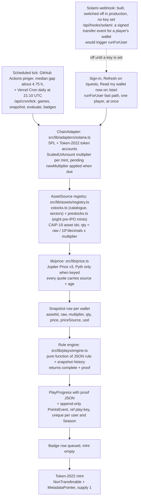
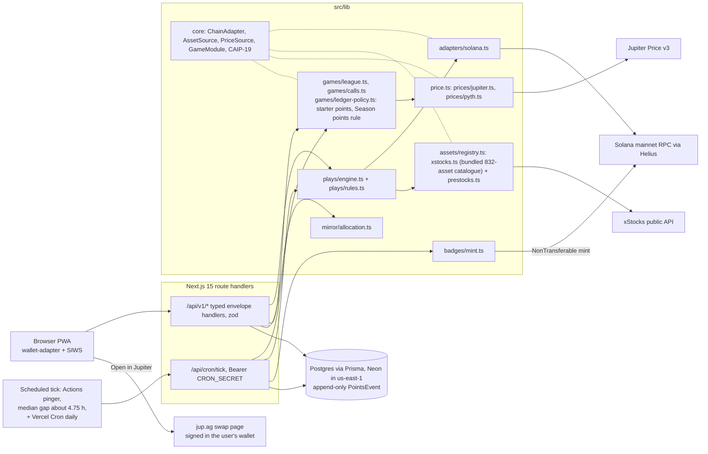

# How Dulo works

The detail behind the [README](../README.md): every page, how points move, the full quest catalogue, how an on-chain quest is verified, the architecture, partners and the known limitations. For setup and deployment see [DEPLOY.md](DEPLOY.md); for the visual system see [DESIGN.md](DESIGN.md).

## Pages

The nav reads Predictions · Competition · Quests · Pre-IPO · Copy a portfolio · Leaderboard, and the phone tab bar reads Predict · Compete · Quests · Board · Profile (five tabs; Pre-IPO is reached from the header and the competition). Every page wears the Live Broadcast design ([DESIGN.md](DESIGN.md)): the week track under the header, serif headlines, near-black ground with cream text, gold only for the one primary action and "now", green and red only for Yes / No and gain / loss.

| Page | What it shows | Sign-in |
|---|---|---|
| `/` | The landing (Live Broadcast, 9 Oct 2026): this week's prediction as the stage with the other questions as tabs, the welcome offer, the three game tiles as lanes on the week, check any wallet and the Stocks Season 0 seats | no |
| `/predictions` | Predictions: points-only Yes or No on Friday closes | to predict |
| `/competition` | Weekly competition (virtual cash): trade form, positions and the board with labelled house bots | to trade |
| `/quests` | Quests: in-platform, on-chain and coming soon, with a proof on every completed on-chain quest | to earn |
| `/prestocks` | Pre-IPO: the eight PreStocks pre-IPO tokens, each with a Jupiter price chip (source and age) and the issuer's mark as a separate number, and paper trades with the competition's virtual cash, 24/7 | to trade |
| `/copy`, `/copy/<wallet>` | Copy a portfolio: pick a wallet, see its allocation, open one Jupiter link per leg | to verify |
| `/check`, `/check/<address>` | Check any wallet: a live read of its xStocks and the on-chain quests it meets, nothing stored | no |
| `/leaderboard` | The Season leaderboard, ranked by Season points, real players only | no |
| `/profile` | Points balance, Season points, points history and badges | yes |
| `/partners`, `/partners/<slug>` | Listed projects, their quests and verified completions | no |

The page paths from before 16 Sep (/plays, /rewards, /league, /paper-trading, /calls and /mirror) redirect permanently to these. The `/api/v1` paths did not move.

There is no deposit, no custody, no broker login and no Anchor program. The only transaction this codebase sends is a soulbound badge mint from a server wallet. Every swap is signed in Jupiter, in the user's own wallet.

Dulo is independent and not affiliated with xStocks. Backed Finance owns that brand.

## How points work

Points only, no cash value. Points live in an append-only `PointsEvent` ledger with a unique ref on every row, and every number below is a sum over that ledger.

- **Three games, one Season leaderboard.** Predictions, the weekly competition (virtual cash) and quests all feed the same Season points. Copy a portfolio is a tool, and a verified copy completes the Portfolio Match quest.
- **1,000 starter points on first sign-in,** once per player per Season. You can put them into predictions, they have no cash value, and they never count toward Season points or rank. House bots never get them.
- **$10,000 of virtual cash per competition week.** It is neither real money nor points. Your competition account opens with your first paper trade, and the app never adds cash and points into one number.
- **Season points = quests + weekly finishes (top 10 with 3+ trades) + settled prediction results.** Starter points, house seed rows and points in open predictions are left out. A prediction counts once it settles: the points back if it settles your way, minus the points you put in if it does not, and zero on a refund.
- **Weekly finishes.** Ranks 1 to 10 by virtual portfolio value earn 1,000 / 700 / 500 / 300 / 200 / 100 / 100 / 100 / 100 / 100 points. Only real accounts with at least 3 trades that week are paid, so a place held by a house bot pays nobody.
- **Quests.** The 10 in-platform quests are worth 1,000 points and use virtual cash and points; two of them, First Pre-IPO Trade and Pre-IPO Trio, count paper trades in PreStocks pre-IPO tokens. The 11 on-chain quests are worth 2,950 points and are verified from your wallet: nine read xStocks and two, Pre-IPO Position and Held Through a Split, read PreStocks pre-IPO tokens. Each on-chain quest describes a wallet state and never tells anyone to buy anything. Partner quests (Kamino Collateral, Jupiter Recurring) are listed as coming soon and cannot be verified yet.
- **Points balance and Season points.** Your points balance is what you can put into predictions: your Season points, plus your starter points, minus the points in your open predictions. The leaderboard ranks Season points. A player with 0 Season points or fewer reads "Not ranked yet".
- **Points cannot be bought, cashed out or sent to another player.** Points only move between players through a shared prediction pool.
- **What partners would pay for.** The plan is that partners list on-chain quests and pay per verified completion. It is only a plan: nothing is billed, no partner has signed and there is no billing code.

### The points economy

| Action | Points | Ledger ref | Limit |
|---|---|---|---|
| Starter points on first sign-in | +1,000 | `starter:<seasonId>` | Once per player per Season, only while the Season is open. Real players only. Can go into predictions, never counts toward Season points or rank. |
| Quest completed | +50 to +500 | `play:<playKey>` | Once per player per quest per Season. |
| Weekly competition finish, ranks 1 to 10 | +1,000 down to +100 | `league:<leagueId>:rank:<n>` | Once per week per place, only for real accounts with 3+ trades that week. A place held by a house bot pays nobody. |
| Points into a prediction, top-ups included | -10 to -5,000 per placement | `call:<marketId>:stake:<userId>:<side>` | The only debit. The balance is checked and debited in one locked transaction, so it never goes below 0. Entries close 24 hours before the Friday close. |
| Prediction settles your way | your share of the whole pool | `call:<marketId>:payout:<userId>` | Once per player per question. No house cut, and never less than you put in. |
| Prediction settles against you | no new row | none | The points you put in already left your balance, and from settlement on they count against Season points. |
| Refund: no usable price within 24 hours, or nobody on the other side | exactly what you put in | `call:<marketId>:refund:<userId>:<side>` | Once per player per side per question. Nets to zero. |
| House bot seed for a prediction pool | each bot's planned points in | `admin:seed:<marketId>:<botUserId>` | House bots only. Never scores, and bots never appear on the Season leaderboard. |
| Paper trade | 0 | none (a competition trade row) | $10,000 of virtual cash per week, $10 minimum, 0.1% virtual spread, in an xStock or a pre-IPO token. Counts toward in-platform quests. |
| Copy a portfolio | 0 | none | Portfolio Match pays +500 once the next snapshot verifies the wallet state. |
| Buy, cash out or send points | not possible | none | Points only, no cash value. |

One ladder covers every quest: 50 to 100 points for a first-minute quest, 150 to 250 for the next tier and 300 to 500 for the hardest. A weekly competition finish (100 to 1,000) sits above any single quest.

The full ledger table, with every limit and the code that enforces it, is in [`docs/HANDOFF.md` §3.8](HANDOFF.md).

## Three games and a tool

### 1. Predictions

- Points-only Yes or No on whether NVDA, TSLA and SPY close above the strike on Friday.
- Each prediction takes 10 to 5,000 points. The dialog defaults to 100, never to your whole balance, and a balance can never go below zero.
- Entries close 24 hours before the Friday close (since 2 Oct 2026, so nobody enters once the answer is nearly known), and settlement falls due 5 minutes after the close. It runs at the next scheduled tick (Vercel's daily run is scheduled for 21:10 UTC, and the free plan may fire it any time in that hour) or the first time a prediction board is read after that, whichever comes first. The side that settles right shares the whole pool pro rata, with largest-remainder rounding, and nobody on it gets back less than they put in. Dulo takes no cut.
- Before you confirm, the dialog warns: "If it doesn't settle your way, the points you put in count against your Season points."
- Settlement reads a price at or after the Friday close (Pyth when a key is set, otherwise Jupiter's quote of the xStock mint), with the source and time printed on the card.
- Everyone gets their points back if nobody took the other side. A market voids and refunds if no usable price arrives within 24 hours.
- Next week's predictions open right after Friday's settlement.
- The fifteen house bot accounts seed the opening pools from house seed rows, never from a player's points. Bots never appear on the Season leaderboard.

### 2. Competition (virtual cash)

- A weekly trading competition with $10,000 of virtual cash at real xStock and pre-IPO prices. It is not real money and places no real trades.
- Fills use lib/price plus a 0.1% virtual spread, and the smallest trade is $10.
- Since 22 Sep the eight PreStocks pre-IPO tokens trade in the same competition from `/prestocks`, with the same virtual cash, around the clock, and count on the weekly board (`LEAGUE_ASSET_SOURCES` in `src/lib/games/league.ts`; a symbol no registered issuer knows is refused). House bots trade xStocks only.
- The week runs Monday 00:00 to Friday 20:00 UTC and settles on its own, at the next scheduled tick or the first read of the board after the close. Weekend trades count toward next week's competition.
- Ranks 1 to 10 earn 1,000 / 700 / 500 / 300 / 200 / 100 / 100 / 100 / 100 / 100 points, but only real accounts with 3 or more trades that week are paid.
- Fifteen house bot accounts keep the board alive. They are labelled and ranked, but never paid, never snapshotted and never shown on the Season leaderboard.

### 3. Quests

A quest is a JSON rule on a database row, validated by a zod schema with eight rule types. Adding a quest means adding a row, not code. No quest tells anyone to buy a security: an on-chain quest describes the wallet state to reach, and its proof shows that the wallet reached it.

**In-platform quests: points and virtual cash** (1,000 points). The prediction and trade routes check these as they run, so the toast arrives in the same response.

| Quest | Rule | What completes it | Points |
|---|---|---|---|
| First Prediction | `internal_event` `call_placed` × 1 | Your first prediction | 50 |
| First Paper Trades | `internal_event` `league_trade` × 3 | Three paper trades | 50 |
| Three Predictions | `call_placed` × 3, one per question | Predictions on three different questions | 75 |
| Paper Portfolio | `league_trade` × 3, one per xStock | Paper trades in three different xStocks | 75 |
| Ten Paper Trades | `league_trade` × 10 | Ten paper trades, from any week | 150 |
| Five-Stock Paper Portfolio | `league_trade` × 5, one per xStock | Paper trades in five different xStocks | 150 |
| Three Game Days | `game_action` × 3, one per UTC day | A paper trade or a new prediction on three different days | 150 |
| Five Predictions | `call_placed` × 5, one per question | Predictions on five different questions, over several weeks | 150 |
| First Pre-IPO Trade | `league_trade` × 1, pre-IPO symbols only | Your first paper trade in a PreStocks pre-IPO token, with virtual cash | 50 |
| Pre-IPO Trio | `league_trade` × 3, one per pre-IPO token | Paper trades in three different pre-IPO tokens, from any week | 100 |

**On-chain quests, verified from your wallet** (2,950 points: nine fenced to xStocks, two to PreStocks pre-IPO tokens).

| Quest | Rule `type` | The wallet state that completes it | Points | Badge |
|---|---|---|---|---|
| First Position | `hold_any` | Any xStock worth $5+ in a connected wallet | 100 | yes |
| Index Holder | `hold_any` | SPYx, QQQx, VOOx or VTIx worth $5+ | 150 | |
| Diversified | `diversified` | 3+ xStocks across 2+ sectors in the same snapshot | 250 | |
| Diamond Hands | `hold_consecutive` | The same xStock in 7 daily snapshots in a row | 300 | yes |
| Steady Buyer | `net_increase_days` | Balance up on 3 separate days inside 14 | 300 | |
| Thousand Club | `hold_any` | A largest single position worth $1,000+ | 300 | |
| Earnings Holder | `hold_through_date` | An xStock held through its company's earnings date | 400 | yes |
| Sector Spread | `diversified` | 5+ xStocks across 4+ sectors in the same snapshot | 400 | |
| Portfolio Match | `mirror_match` | An allocation within 20% of a portfolio you chose to copy | 500 | yes |
| Pre-IPO Position | `hold_any` | Any PreStocks pre-IPO token, whatever the amount, counted by the token and not by a price (fenced to the `prestocks` source) | 100 | |
| Held Through a Split | `multiplier_change` | A pre-IPO token held across an on-chain adjustment: the same raw balance in two daily snapshots with a new multiplier between them (fenced to the `prestocks` source; an adjustment changes the number of tokens shown, not the holder's value) | 150 | |

**Coming soon from partners.** These are seeded inactive and never evaluated. No partner has signed.

| Quest | Partner | Wallet state | Points |
|---|---|---|---|
| Kamino Collateral | Kamino | SPYx or QQQx posted as collateral in Kamino's xStocks market | 300 |
| Jupiter Recurring | Jupiter | An active Recurring order into an xStock | 200 |

**Names in code.** The product says quests, the competition, predictions and copy a portfolio. The code kept its original internal names, so Prisma models, `playKey` values, file names and `/api/v1` paths still say Play, League, Call and Mirror. The diagrams and file paths below use the code names on purpose. The old page paths redirect permanently to the new ones.

### Copy a portfolio (a tool)

- Pick a wallet: a Season leader, one of ten curated public holders (not Dulo players, never scored), a paper model portfolio, or any address you paste.
- See its allocation, plus its 7d / 30d value change when it has snapshot history.
- Enter a USDC budget and open one prefilled Jupiter swap per leg: `https://jup.ag/swap?sell=<USDC>&buy=<xStock>&inAmount=<usdc>`. You sign each swap in your own wallet. Legs worth under $1 are dropped.
- Press "I've done my swaps". That reads your wallets again at once, and every later read (Refresh, sign-in or the scheduled tick) checks again; the tool only says that a read checks whether your wallet matches. The Portfolio Match quest completes when every leg is within 20%, the total distance is within 20% and the copy is worth at least $1.

### Badges: what a big quest leaves in your wallet

Four quests (First Position, Diamond Hands, Earnings Holder, Portfolio Match) and a top-three finish in the weekly competition (Podium Finish) queue a soulbound Token-2022 badge mint. Each badge is its own Token-2022 mint with the NonTransferable and MetadataPointer extensions, 0 decimals and a supply of 1. The mint authority is removed in the same transaction. The metadata is served from `/api/v1/badges/<key>/metadata.json`.


## How an on-chain quest verifies



### Solami webhooks: built, switched off until a key is set

Today an on-chain quest completes at sign-in, when the player presses Refresh on `/quests` (or Read my wallet now on `/start`, both limited to once a minute), or at the next scheduled tick, which runs hours apart on the free plan. The Solami webhook is built to close that gap, but it is **not configured in production**: no Solami key is set, so `/api/hooks/solami` answers 503 and nothing completes within seconds of a transfer today. With a [Solami](https://solami.dev) key, one Solami webhook would watch every real player's linked wallets (never a house bot's), filtered server-side to token transfers of the xStocks and PreStocks mints, and POST each matching transaction to `/api/hooks/solami` as it lands.

- **A trigger, not a source of truth.** The route checks the `X-Webhook-Signature` HMAC (SHA-256 of the raw body under `SOLAMI_WEBHOOK_SECRET`), drops Solami's retries by transaction signature, maps the addresses in the event to real players' Wallet rows, and runs `runForUser` after the 200 is sent. That re-reads the holdings through the ChainAdapter and evaluates the quests exactly as the cron does, so nothing in the payload is ever scored.
- **The watch list keeps itself current.** A sign-in that links a new wallet updates the webhook's address list (`src/lib/cron/solami-sync.ts`).
- **Health.** `GET /api/hooks/solami` reports deliveries, rejected signatures, retries dropped, deliveries that matched a player, and the last triggered re-read (how long it took and how many quests it completed). Counts are per server instance.
- **Code.** `src/lib/adapters/solami.ts` (signature, payload walk, replay guard, webhook spec and client), `src/app/api/hooks/solami/route.ts`, `scripts/solami-webhook.ts`; tests in `tests/solami-webhook.test.ts` and `tests/solami-sync.test.ts`.

Point it at your own key:

```bash
# a standard Solami key with the WebhooksManage role; production variables loaded in the shell
SOLAMI_API_KEY="<key>" npm run solami:webhook   # creates the webhook, prints SOLAMI_WEBHOOK_ID and SOLAMI_WEBHOOK_SECRET once
# set SOLAMI_API_KEY, SOLAMI_WEBHOOK_ID and SOLAMI_WEBHOOK_SECRET in the deployment and redeploy
curl -s "$APP/api/hooks/solami" | jq .data      # delivery health
```

Without a key, which is production today, nothing changes: the route answers 503, and quests keep verifying at sign-in, on Refresh and at the scheduled tick.

The Diversified rule, exactly as stored on its row (`src/lib/plays/catalogue.ts`):

```json
{ "type": "diversified", "minAssets": 3, "minSectors": 2 }
```

The proof the engine writes when that rule completes. The field names come from `evalDiversified`; the values below are **illustrative**, not a real wallet:

```json
{
  "takenAt": "2026-09-16T14:05:00.000Z",
  "assets": [
    { "symbol": "NVDAx", "sector": "Technology", "usd": 12.41 },
    { "symbol": "SPYx", "sector": "Index", "usd": 10.02 },
    { "symbol": "TSLAx", "sector": "Consumer Discretionary", "usd": 9.87 }
  ],
  "sectors": ["Consumer Discretionary", "Index", "Technology"],
  "assetCount": 3,
  "sectorCount": 3,
  "minAssets": 3,
  "minSectors": 2,
  "minUsd": 1
}
```

The same tick also writes:

- the `PlayProgress` row: status `complete`, `completedAt` = the snapshot time, and the proof above;
- one `PointsEvent` with ref `play:diversified` and delta `+250`.

`@@unique([userId, seasonId, ref])` means a retry or a crash can never pay twice. The starter grant uses the same key (`starter:<seasonId>`), so two sign-ins at once still write one row. A completion is sticky. In-platform quests use the same engine: `internal_event` rules count paper trades and predictions from the database instead of snapshots.

## Architecture



Rules the codebase keeps:

- All chain reads go through `ChainAdapter`, all asset math through `AssetSource` and all prices through `lib/price`. There is no raw RPC in routes or components.
- Every UI read goes through a `/api/v1` handler. The Next.js app is one client of that API, with no private back door.
- Asset ids are CAIP-19 strings (`solana:5eykt4UsFv8P8NJdTREpY1vzqKqZKvdp/token:<mint>`). A user owns many wallets, and nothing keys on a single pubkey.
- Points are an append-only `PointsEvent` ledger; balances are derived. The leaderboard, rank, profile and copy leaders all read Season points through the same query rule, so they always agree.
- House bots are filtered out of every Season read in the database, never receive starter or quest points, and cannot sign in.
- Every price shown carries its source and age. The app works with markets closed.

## Partners

**How a listing works.** A Partner is a row with one Campaign per Season, and its on-chain quests are JSON rules on that Campaign. In Season 0, Partners are seeded by hand from `src/lib/plays/partners.ts` and `src/lib/plays/catalogue.ts`; the seed upserts them, and there is no self-serve dashboard. Each listed project gets a page at `/partners/<slug>` with its quests and per-quest completion counts from real players (bots excluded). The "Talk to us" button on `/partners` appears when a contact is configured.

**Honest labels.** A Partner shows **Quests live** only when it has at least one verifiable quest; otherwise it shows **Coming soon**. No project has signed anything, and a listing is not an endorsement.

| Partner | Label | What is listed |
|---|---|---|
| xStocks | Quests live | Nine on-chain quests verified from xStocks holdings |
| PreStocks | Quests live | Two on-chain quests, Pre-IPO Position and Held Through a Split, verified from PreStocks pre-IPO token holdings |
| Jupiter | Coming soon | A Recurring-order quest (the copy tool's swap links already open jup.ag) |
| Kamino | Coming soon | A collateral quest, to be read from Kamino's public API |

Dulo's in-platform quests sit under a hidden house partner that is not listed. There are no placeholder listings. Partner marks belong to their owners; inclusion does not imply endorsement.

## Known limitations

- **Brand new.** Live since 21 Sep 2026 (at https://projectdulo.com since 7 Oct) with no external players yet (one account so far: the founder's), so the Season leaderboard is empty and no badge has been minted. It runs on Vercel's free plan, so there is no five-minute tick: the scheduled tick (games, snapshot, evaluate, badges) comes from a GitHub Actions pinger whose median gap has been about 4.75 hours, plus Vercel's daily run. A player's wallets are also read and their quests evaluated at sign-in and when they press Refresh (once a minute at most), and since 7 Oct the prediction and competition boards run an overdue settlement or weekly rollover themselves when they are read (`src/lib/cron/catch-up.ts`). Without a Helius or Jupiter key the public RPC and keyless Jupiter rate-limit under load.
- **No Pyth key.** Pyth Hermes needs a key and Season 0 runs without one. Jupiter Price v3 therefore prices the competition and settles the predictions, and the source and age are printed on every chip and card. Outside the US session a price is Jupiter's last quote; after 6 hours it is marked stale.
- **Entries close 24 hours before the Friday close (since 2 Oct 2026).** That removes the near-riskless last-minute entry against the house-bot pools; a Thursday entry still carries a day of price risk. Next week's questions still open after Friday's settle.
- **Throwaway accounts.** Someone can put a throwaway account's starter points on the side that is about to lose, which moves those points to their main account as Season points. A new-account limit of 20 an hour per network only slows this down, and it lives in memory on each server instance. The planned fix weights accounts by account or wallet age, never by holdings.
- **The earnings calendar is hand-maintained.** `src/lib/plays/earnings-2026.json` covers 58 tickers. Dates inside the Season 0 judging window (14 Sep to 2 Oct 2026) are checked against each company's announcement; later dates follow each company's usual reporting window and must be re-checked once announced. An xStock without a date cannot complete Earnings Holder.
- **Copied-portfolio value change is not cash-flow adjusted.** The 7d / 30d figures compare total position value, so a deposit reads as a gain. The UI labels it "value change".
- **Logout is stateless.** A session is a 30-day HS256 JWT in an httpOnly cookie. Logout clears the cookie but does not revoke a token already issued.
- **The `bigint: Failed to load bindings, pure JS will be used` warning is expected.** A transitive Solana dependency prints it during tests and builds, and it is harmless.
- **Check any wallet is one live read.** On-chain quests that need daily history (Diamond Hands, Steady Buyer, Earnings Holder) show "Needs daily snapshots". The per-IP and per-instance rate limits live in memory.
- **The Solami webhook is built and switched off.** No Solami key is set in production, so `/api/hooks/solami` answers 503 and nothing completes within seconds of a transfer today; quests verify at sign-in, on Refresh and at the scheduled tick. Switching it on needs a Solami plan that includes a webhook, and even then it is only a trigger; its delivery health lives in memory per server instance.
- **The Jupiter Recurring and Kamino quests are coming soon.** They are listed but cannot be verified yet.
- **PreStocks pre-IPO tokens trade on thin pools and are Jupiter-only priced.** None of the eight has a Pyth feed, so a pre-IPO price is always Jupiter's quote from a thin Meteora pool, with its source and age shown. The issuer's mark (`markPrice` from the PreStocks API) is a separate number and not a tradeable quote; the app never presents the gap between the two as a discount. Pre-IPO Position is therefore count-based, and the copy tool stays xStocks-only. Since 22 Sep the competition does trade them, with virtual cash, and a pool that thin means a virtual-cash trade fills at a quote that a real trade of the same size would move, so a paper fill there is not a price a real trade would get. Points only, so nobody rational moves a market for them, and house bots do not trade them.
- **Held Through a Split cannot have completed yet.** Both PreStocks adjustments on record (SpaceX's 5-for-1, effective 10 Jun 2026, and OpenAI's x1.4861, effective 17 Jul 2026, read from each mint's ScaledUiAmount config) predate Dulo's first production snapshot on 21 Sep 2026, so no wallet on record held through either. The quest completes on the next adjustment, and its copy says so. An adjustment changes the number of tokens shown, not the holder's value, and the app never presents one as a price signal.
- **More in the handoff.** The full list, with a planned fix for each, is in `docs/HANDOFF.md` §3.9.
